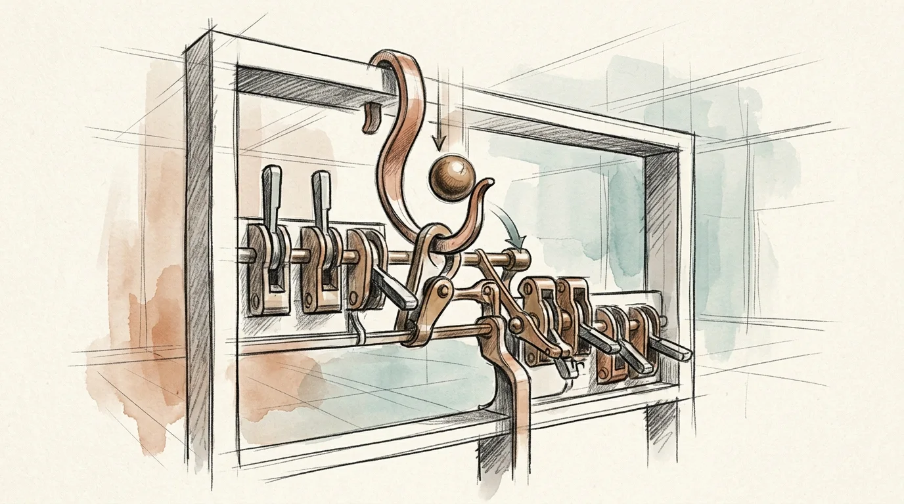

# CreateHook

Generate lifecycle hooks for AI agent runtimes (Claude Code, OpenCode, OpenClaw, Hermes Agent). USE WHEN writing, wiring, or debugging an event hook, plugin hook, or agent automation trigger.

[Read the skill documentation](SKILL.md) · [Browse the library showcase](../../showcase.md)
