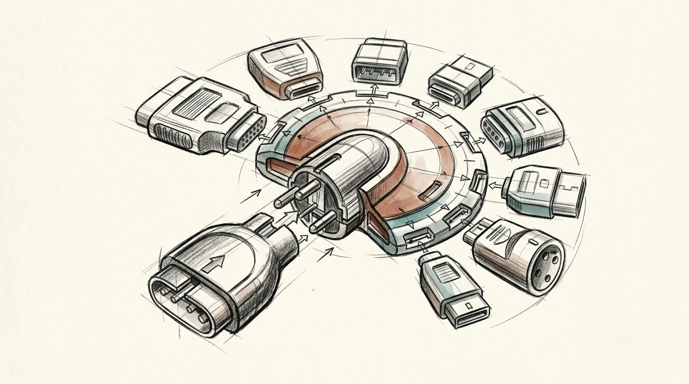

# CreatePlugin

Package a project as an AI-agent plugin with Hermes, Claude, OpenClaw, Pi, OpenCode, and MCP adapters. USE WHEN porting workflows across agent hosts. NOT FOR standalone CLIs (use CreateCLI).

[Read the skill documentation](SKILL.md) · [Browse the library showcase](../../showcase.md)
