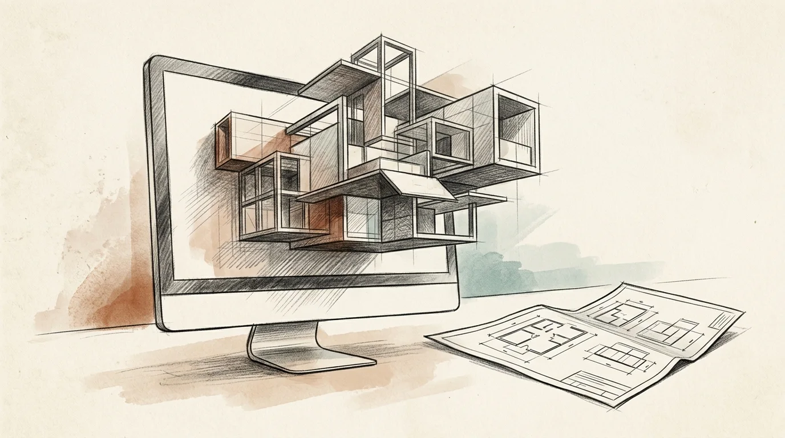

# MacPluginPlaybook

Phased playbook to build or port a native SwiftUI macOS menu bar app. USE WHEN starting or porting a macOS menu bar plugin. NOT FOR one view's styling (use MacUX).

[Read the skill documentation](SKILL.md) · [Browse the library showcase](../../showcase.md)
