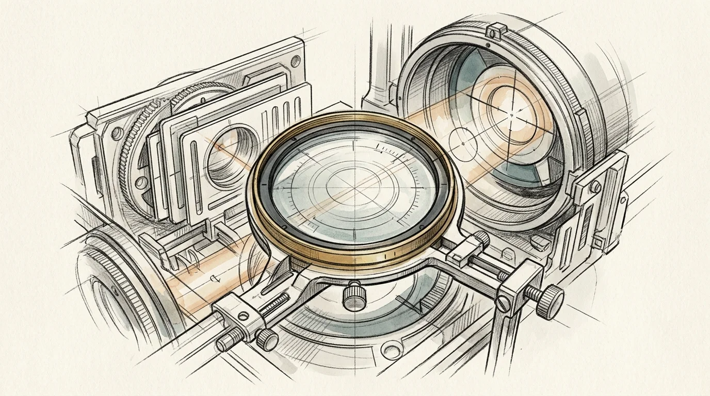

# ModelUpgrade

Re-tune skills for a new model generation: judge relevance and fit, then reprompt, replan, or retire. USE WHEN a new model ships or skills feel dated. NOT FOR agentic-readiness audits (use SkillForge).

[Read the skill documentation](SKILL.md) · [Browse the library showcase](../../showcase.md)
